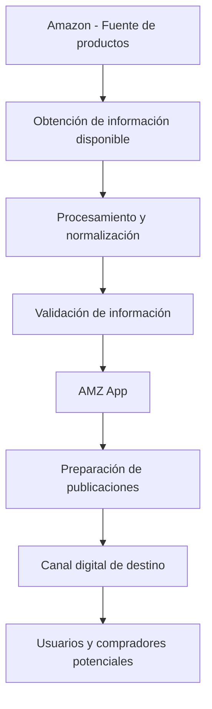

### Publicación inteligente de productos de Amazon

**Catálogo · Publicación de productos · Contenido comercial · Automatización**

**Simplificamos la gestión y publicación de productos mediante tecnología y automatización.**

[🌐 www.mecoamz.com](https://mecoamz.com/)

---

## 🛒 Acerca de AMZ App

**AMZ App** es una plataforma tecnológica especializada en la **gestión, preparación y publicación de productos provenientes del catálogo de Amazon**.

Nuestra solución está diseñada para optimizar los procesos relacionados con la identificación, organización y preparación de información comercial de productos, facilitando la creación de publicaciones estructuradas y profesionales para canales digitales.

A través de herramientas de procesamiento de datos, generación de contenido y automatización, buscamos reducir las tareas manuales asociadas a la administración de catálogos y mejorar la calidad de la información presentada en cada publicación.

Nuestro propósito es convertir la información disponible de los productos en contenido comercial organizado, consistente y útil para los procesos de publicación digital.

**En AMZ App conectamos tecnología, información de productos y automatización para hacer que publicar sea más sencillo y eficiente.**

---

## 📦 ¿Qué ofrecemos?

AMZ App está orientada a facilitar la preparación y gestión de publicaciones a partir de información disponible de productos de Amazon.

- 🛍️ **Gestión de productos:** organización de referencias, títulos, características y atributos comerciales.
- 📝 **Generación de descripciones:** preparación de contenido comercial claro, estructurado y profesional a partir de información disponible.
- 🔎 **Procesamiento de catálogos:** organización y normalización de datos para facilitar la administración de productos.
- 🖼️ **Gestión de imágenes:** administración de recursos visuales asociados a las referencias.
- 🏷️ **Clasificación de productos:** organización de artículos según sus categorías y características.
- 💰 **Información comercial:** procesamiento de precios y demás datos disponibles en las fuentes integradas.
- ✅ **Validación de contenido:** identificación de datos incompletos, inconsistencias y especificaciones que requieren revisión.
- ⚙️ **Automatización de publicaciones:** optimización de tareas repetitivas relacionadas con la preparación de productos.
- 🔗 **Integración de información:** aprovechamiento de fuentes de datos y servicios compatibles con la plataforma.
- 📊 **Gestión eficiente del catálogo:** herramientas orientadas a mejorar la organización y el seguimiento de los productos procesados.

Nuestra prioridad es preparar publicaciones consistentes y profesionales, respetando la información disponible y evitando incorporar características, especificaciones o beneficios que no estén respaldados por las fuentes.

---

## 🚀 ¿Qué estamos construyendo?

Desarrollamos una plataforma tecnológica enfocada en optimizar el proceso de preparación y publicación de productos, desde la obtención de información hasta la generación del contenido comercial.

- **Publicación de productos:** preparación de la información necesaria para presentar productos en canales digitales.
- **Gestión de catálogos:** administración organizada de referencias, categorías, características y atributos.
- **Generación de contenido comercial:** estructuración de títulos y descripciones adaptados a las necesidades de publicación.
- **Procesamiento de información:** transformación y normalización de datos provenientes de las fuentes disponibles.
- **Enriquecimiento de productos:** aprovechamiento de información previamente obtenida y validada para mejorar la presentación comercial.
- **Gestión de imágenes:** organización de las imágenes relacionadas con los productos.
- **Control de calidad:** validación de la consistencia y completitud de la información antes de su utilización.
- **Automatización:** reducción de procesos manuales mediante flujos de trabajo tecnológicos.
- **Integraciones:** conexión con servicios y fuentes compatibles con la arquitectura de la aplicación.
- **Actualización de información:** mecanismos para administrar los cambios en los datos disponibles, cuando las integraciones lo permitan.
- **Escalabilidad:** preparación de la solución para gestionar catálogos de mayor tamaño y nuevas funcionalidades.
- **Analítica:** posibilidades de seguimiento de los procesos de preparación y publicación.

El objetivo es construir una solución que facilite la operación comercial y permita gestionar productos de forma más organizada, eficiente y escalable.

---

## 🌐 Nuestro modelo de operación

AMZ App utiliza información disponible de productos de Amazon como punto de partida para preparar y gestionar publicaciones digitales.

Nuestro enfoque consiste en centralizar y simplificar el flujo de trabajo, facilitando la transformación de la información de origen en publicaciones organizadas y listas para su gestión.

La información, las imágenes, los precios y la disponibilidad dependen de los datos accesibles y de las condiciones de uso de cada fuente.

Los canales de destino y el nivel de automatización dependerán de las integraciones y funcionalidades implementadas en la plataforma.

---

## 🛠️ Áreas de desarrollo

| Área | Objetivo |
|---|---|
| Publicaciones | Preparar, estructurar y administrar contenido comercial. |
| Catálogo | Organizar productos, referencias, categorías y atributos. |
| Procesamiento de datos | Transformar y normalizar la información de origen. |
| Contenido comercial | Generar títulos y descripciones profesionales. |
| Gestión de imágenes | Administrar los recursos visuales disponibles. |
| Validación | Revisar la integridad y consistencia de la información. |
| Automatización | Optimizar tareas repetitivas del proceso de publicación. |
| Integraciones | Facilitar la conexión con fuentes y servicios compatibles. |
| Actualización | Gestionar cambios en los datos disponibles. |
| Experiencia de usuario | Construir interfaces intuitivas y eficientes. |
| Analítica | Facilitar el seguimiento de los procesos y resultados. |
| Infraestructura | Favorecer la seguridad, disponibilidad y escalabilidad. |

---

## 📂 Nuestros proyectos

En esta organización de GitHub encontrarás los repositorios tecnológicos relacionados con el desarrollo y la evolución de **AMZ App**.

- Aplicaciones web y componentes de interfaz.
- Servicios backend y APIs.
- Herramientas de gestión y publicación de productos.
- Procesamiento y normalización de catálogos.
- Administración de productos, categorías y atributos.
- Generación de títulos y descripciones comerciales.
- Gestión de imágenes y contenido digital.
- Validación y control de calidad de datos.
- Integraciones con fuentes de información de productos.
- Automatización de procesos comerciales.
- Actualización y administración de información.
- Infraestructura, configuración y despliegues.
- Herramientas de seguimiento y administración.
- Documentación técnica y mantenimiento de la plataforma.

> Algunos repositorios pueden ser privados debido a que contienen componentes internos, configuraciones, integraciones o información propia de la plataforma.

---

## 🎯 Nuestra visión

Consolidar **AMZ App** como una plataforma tecnológica eficiente para la gestión y publicación de productos, aprovechando la información disponible en catálogos comerciales como Amazon.

Buscamos simplificar los procesos operativos, reducir el trabajo manual y mejorar la calidad del contenido comercial mediante herramientas que permitan procesar información de manera organizada y consistente.

Nuestra visión es facilitar la administración de grandes volúmenes de productos, optimizar los tiempos de preparación de publicaciones y ofrecer una infraestructura tecnológica preparada para evolucionar junto con las necesidades del negocio.

Queremos que la tecnología permita convertir procesos complejos y repetitivos en flujos de trabajo más simples, controlados y eficientes.

---

## 💡 Nuestros principios

- **Precisión:** utilizar información respaldada por las fuentes disponibles.
- **Calidad:** priorizar publicaciones organizadas, claras y consistentes.
- **Integridad:** evitar la incorporación de especificaciones o características no verificadas.
- **Innovación:** aprovechar la tecnología para mejorar los procesos comerciales.
- **Simplicidad:** facilitar la gestión de productos y la preparación de publicaciones.
- **Automatización:** reducir tareas manuales y repetitivas.
- **Eficiencia:** optimizar los recursos y tiempos de operación.
- **Escalabilidad:** construir una solución preparada para crecer.
- **Mantenibilidad:** desarrollar componentes claros y fáciles de actualizar.
- **Seguridad:** proteger las credenciales, los datos y las configuraciones de la plataforma.

---

## 🔒 Seguridad

La seguridad es una prioridad en el desarrollo de **AMZ App**.

Aplicamos buenas prácticas orientadas a proteger la información y mantener una infraestructura tecnológica confiable.

Recomendamos:

- Utilizar variables de entorno para gestionar credenciales y configuraciones sensibles.
- Evitar publicar claves API, tokens o contraseñas en los repositorios.
- Restringir los permisos de acceso según las responsabilidades de cada usuario.
- Mantener actualizadas las dependencias y los componentes tecnológicos.
- Gestionar las integraciones de acuerdo con las condiciones de acceso y seguridad correspondientes.
- Evitar divulgar vulnerabilidades o información sensible en issues públicos.

Si identificas una vulnerabilidad, comunícate de manera privada con el equipo responsable para facilitar su revisión y tratamiento.

---

## 📋 Consideraciones sobre Amazon

Amazon y sus marcas son propiedad de sus respectivos titulares. La referencia a sus productos no implica, por sí sola, afiliación, patrocinio o respaldo por parte de Amazon.

El uso de información comercial, imágenes, marcas y otros recursos de terceros debe ajustarse a las condiciones de uso de las fuentes correspondientes, las autorizaciones aplicables y las políticas de los canales de publicación.

Los precios, las características y la disponibilidad de los productos pueden cambiar. Por ello, la información debe verificarse y actualizarse de acuerdo con las capacidades de integración disponibles.

AMZ App tiene como objetivo facilitar la gestión tecnológica de las publicaciones sin sustituir la validación de la información ni los requisitos aplicables a cada canal de comercialización.

---

## 📬 Conoce AMZ App

Explora nuestra plataforma y conoce nuestra propuesta tecnológica para la gestión y publicación de productos.

### 🌐 [www.mecoamz.com](https://mecoamz.com/)

---

### Tecnología para publicar mejor. Automatización para crecer.

 

  

**© 2026 AMZ App. Todos los derechos reservados.**

[Visitar mecoamz.com](https://mecoamz.com/)

